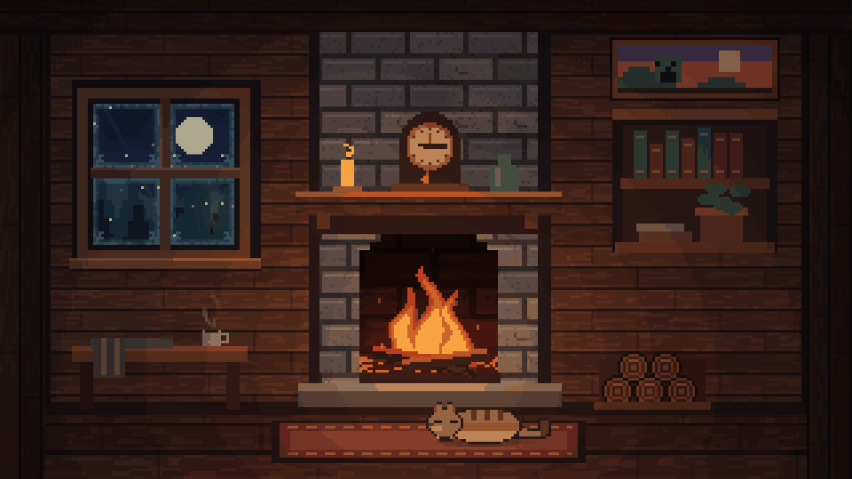
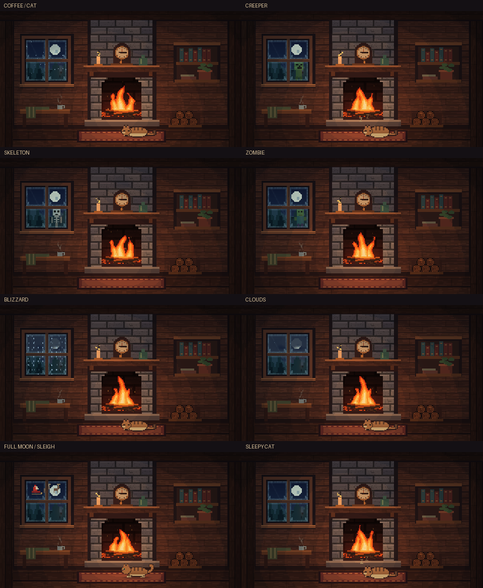

# Hearth — тихий вечер

Уютный пиксельный домик: живой огонь, каменная кладка, тёплое дерево,
книги, плед, свеча, горячий кофе и заснеженный лес за окном. Настроение Terraria / Minecraft,
оригинальная процедурная графика без игровых ассетов и внешних текстур.



## Запуск

```powershell
git clone https://github.com/v1beinc/hearth.git
cd hearth
uv run hearth.py
```

Python 3.11+ и `uv`. Зависимости указаны в PEP 723-заголовке скрипта.
Конфиг `hearth.toml` открывает приложение на втором мониторе (`monitor = 1`);
если его нет, приложение автоматически выбирает основной.
Для основного монитора: `uv run hearth.py --monitor 0`.

Для обычного окна:

```powershell
uv run hearth.py --windowed 1280x720
```

## Управление

| Клавиши | Действие |
|---|---|
| `Q` / `Esc` | Закрыть |
| `F` | Полный экран / окно |
| `Space` | Пауза / продолжить |
| `H` / `F1` | Справка |
| `W` | Погода: авто / ясно / снег / метель / облачно |
| `E` | Ускоренный просмотр редких событий |
| `1`–`4` | Вечер / тихая ночь / жаркий огонь / ретро |
| `[` / `]` или стрелки | Скорость анимации |
| `-` / `=` | Интенсивность и освещение комнаты |
| `,` / `.` | Размер пикселей |
| `R` | Вернуть настройки запуска |
| `S` | Сохранить PNG в `out/` |
| `C` | Напечатать текущие параметры |

Параметры в `hearth.toml` применяются при следующем запуске.
CLI переопределяет конфиг, например `--set uIntensity=0.8`.

## Жизнь домика

Над чашкой поднимается пар. Часы на камине показывают текущее время МСК
(UTC+3), независимо от часового пояса компьютера; даже на паузе они продолжают
идти. Источник времени — системные часы, подключение к интернету не требуется.

За окном снег сменяется метелью, облака закрывают и открывают луну.
Изредка крипер, скелет или зомби подходят, смотрят в комнату и уходят.
В ясное полнолуние может пролететь Дед Мороз на санях с оленями.
Иногда падает звезда. Погода и лунный календарь — часть анимации,
а не реальные метеоданные или астрономический календарь.

Рыжая кошка заходит справа, ложится перед огнём и затем уходит.
Во сне живот поднимается и опускается, а над ней появляются «Zzz»:
храп показан визуально, звука пока нет.
Она постепенно опускает голову, подбирает лапы и укладывает хвост,
а перед уходом встаёт. Шаги зависят от пройденного расстояния;
тонкий контур и контактная тень отделяют её от поленьев и коврика.

Обычный режим сохраняет длинные спокойные промежутки. `E` ускоряет календарь
событий в восемь раз и увеличивает вероятность гостей; для просмотра саней
выберите ясную погоду клавишей `W`. Камин, пар и дыхание остаются плавными.
`uSteam` регулирует пар; `uLife = 0` отключает гостей, кошку и сани.



## Как устроен визуал

Сцена нарисована в одном GLSL-шейдере. Базовый холст — 320×180:
целые пиксели, согласованные силуэты, небольшие текстуры дерева и камня.
При изменении разрешения размер пикселей подстраивается; на узком экране
помещается вся комната, на широком продолжаются стены. Фильтрации нет.

Огонь состоит из трёх движущихся языков с отдельной шестицветной палитрой,
углей и редких искр. Свет меняется вместе с пламенем и падает на материалы;
холодный лес за окном сохраняет собственную экспозицию. Анимация идёт
с частотой `uFps`, по умолчанию 12 кадров/с; приложение обновляет окно
до 30 раз/с с учётом vsync. Курсор в полном экране скрывается после трёх секунд
бездействия. Снимки `S` сохраняются без справки и уведомлений, с уникальными именами.

Огонь мягко подсвечивает пол и отбрасывает подвижные рассеянные тени
от часов, чашки, бутылки и полки. На отдельных стёклах — тонкий иней
с маленькими кристаллами по краям, холодный блик и слабое отражение огня.
Гости и луна остаются видны сквозь стекло.

`uPixel = 6` — исходная сетка; большие значения делают картинку грубее.
Это размер блока относительно 1080p, а не фиксированный размер на любом мониторе.
`uSteps` управляет ступенями света; `uDither` — лёгким дизерингом их границ.
Текстуры остаются пиксельными даже при уменьшении `uPixel`.

## Файлы и превью

- `hearth.py` — приложение, управление и снимки.
- `hearth.toml` — настройки.
- `shaders/hearth.frag` — актуальный домик.
- `shaders/hearth2.frag` — прежний вариант каменной комнаты.
- `shaders/fire.frag` — отдельное гладкое пламя.
- `tools/render_still.py` — GPU-рендер кадра и замер времени; defaults шейдеров.
- `tools/capture_cabin.py` — PNG и запись пяти секунд в GIF.
- `tools/scene_clock.py` — московское время и часы для воспроизводимых кадров.
- `tools/preview.html` — WebGL-превью того же шейдера.
- `tests/` — проверки GPU-пикселей, контракта хостов и реального event loop.
- `out/` — локальные рендеры; `out/reference/` в рабочей копии автора хранит
  предыдущие варианты. Эти временные файлы не входят в репозиторий.
- `terminal_fireplace_cinematic.py` — отдельный исходный терминальный прототип.

```powershell
# Кадр и стоимость отрисовки на вашей GPU
uv run tools/render_still.py --shader hearth --t 55 --clock 21:15 --size 1920x1080 --bench 120 --out out/still.png

# Обновить PNG и анимированное превью
uv run tools/capture_cabin.py

# Записать ускоренное появление крипера и кошку
uv run tools/capture_cabin.py --start 9.5 --showcase --name cabin-events

# Живое локальное WebGL-превью
python -m http.server 8765 --bind 127.0.0.1
# Открыть http://127.0.0.1:8765/tools/preview.html?shader=hearth
```

В браузере управление появляется при движении мыши. Есть пресеты, пауза
и полный экран; `Space`, `1`–`4`, `F`, `R`, `W`, `E` работают с клавиатуры.
`H` показывает помощь, `D` — статистику. `?debug=1` включает статистику сразу.
`?t=12` фиксирует анимацию и часы (21:15); `?clock=09:30:00` задаёт другие часы.
`?size=1920x1080` задаёт framebuffer; без него размер подстраивается под окно.

## Проверка

```powershell
uv run --with pytest --with moderngl --with pyglet --with numpy --with pillow python -m pytest tests -q
```

Проверено 5 октября 2026: все 81 проверка прошла; новая сцена компилируется
и отрисовывается в приложении и WebGL. Проверки включают цвет и границы
пламени, свет на камне, изменение во времени, остановку анимации,
целочисленное увеличение без размытия, портретный и широкий экран.
Добавлены GPU-проверки пара, стрелок часов, визитов и границ окна, погоды,
саней и дыхания кошки. В реальном event loop проверено, что часы обновляются
при остановленной анимации; отдельно проверены смена даты по МСК и формат времени.
Проверки соседних кадров ловят резкий скачок позы при укладывании и вставании;
проверка стекла подтверждает тёплое отражение при сохранении холодной палитры неба.

На RTX 3050 Laptop GPU отдельный offscreen-замер обновлённой сцены с кошкой
в 1080p дал **2.15 мс/кадр** (60 кадров); при 2560×1440 — **3.35 мс/кадр**
(120 кадров). Это стоимость шейдера, а не обещание FPS приложения:
на него влияют vsync, монитор и оконная система. Оценку эстетики тесты не заменяют.

Звука пока нет.
